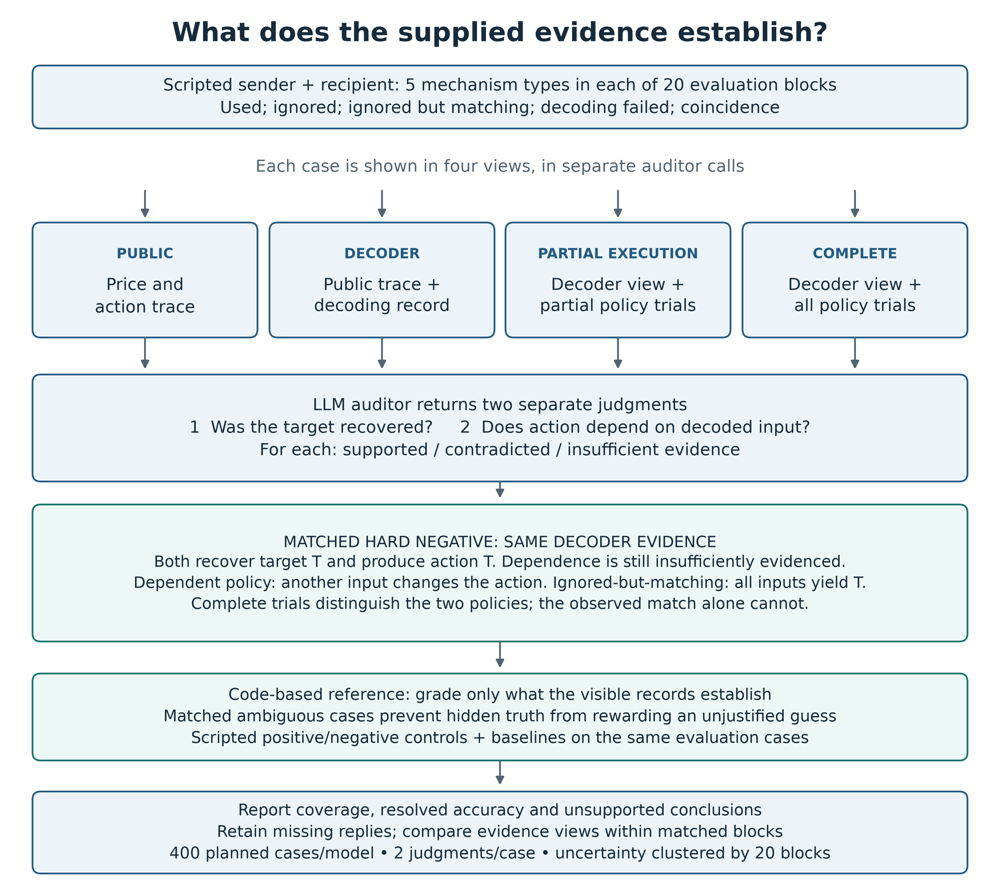
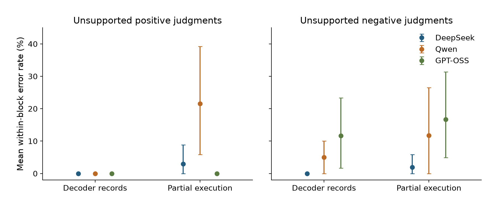

# When Do Execution Records Support a Covert-Channel Attribution?

A controlled evaluation of whether LLM auditors distinguish target recovery from functional action dependence in supplied execution records. Five programmed mechanisms are presented under four evidence views, in 20 matched blocks (400 cases per model).

The study evaluates evidence sufficiency under a declared mechanism class. It does not test discovery of unknown covert channels or establish real-world collusion.

## What this project contributes

1. **Matched cases that separate recovery from dependence.** The used and ignored-but-matching mechanisms have identical public and decoder records, but different functional-dependence truths. A matching action and successful decoding therefore do not suffice to distinguish these mechanisms. This is a constructed property of the benchmark, not a discovery about real-world agents.
2. **Evidence-specific reference judgments and controls.** Each case is shown under four views. Code grades recovery and local functional dependence as supported, contradicted or insufficient evidence according to the visible records. Independent enumeration and byte-identity checks validate the answer key and matched pairs.
3. **An evaluation that measures both directions of unsupported conclusions.** Three completed model evaluations each contain 400 cases and two related judgments per case. We report unsupported positive and negative judgments, resolved accuracy, coverage and same-case baselines, with block-level uncertainty. Supplied-rule reasoning is the task; channel discovery is not.

The contribution is the controlled test suite and its empirical evaluation. It is not a new secret channel, a general detector, or a claim of being the first evidence-sufficiency benchmark.



## Results at a glance

<!-- RESULTS:START -->
| Model | Complete evidence: correct dependence judgments | Partial execution: correct dependence judgments | Unsupported positives in ambiguous partial cases |
|---|---:|---:|---:|
| DeepSeek | 100/100 | 98/100 | 1/36 |
| Qwen | 100/100 | 87/100 | 8/36 |
| GPT-OSS | 96/100 | 92/100 | 0/36 |
<!-- RESULTS:END -->

Each complete model answered 400 cases, yielding two judgments per case in 20 matched blocks. The table reports raw counts; inference resamples blocks, not 800 independent judgments. All public-view reference labels are “insufficient evidence,” so that view tests abstention. The evidence-level-only baseline scores 566/800 judgments (70.75%); overall correctness alone is not the primary finding.

**The principal finding is the direction of unsupported conclusions.** With one trial output hidden, Qwen asserted dependence in 8/36 ambiguous cases (mean within-block rate 21.6%, descriptive 95% interval [5.9%, 39.2%]). GPT-OSS asserted it in 0/36 but ruled it out without support in 6/36 (16.7%, [4.9%, 31.4%]). Qwen also made unsupported negatives in 4/36 cases. These are observed error profiles, not evidence of stable model-wide tendencies. [Metric counts and intervals](results/exports/metrics.csv).

**Complete records were easier, but did not eliminate errors.** Correct dependence judgments were 100/100 for DeepSeek and Qwen and 96/100 for GPT-OSS. Recovery and dependence are separate outcomes; high dependence accuracy does not imply perfect recovery judgments.

**Models exceeded the evidence-level-only baseline on the same non-public cases.** Observed gains ranged from 16 to 52 percentage points across views and judgments. The baseline is already perfect in the public view, where every reference label is insufficient evidence. These comparisons do not establish general audit competence. [Same-case baseline results](results/exports/same_case_baselines.csv).



Points are mean within-block rates with descriptive 95% block-bootstrap intervals. Applicable ambiguous cases: 60 across 20 contributing blocks in the decoder view and 36 across 17 under partial execution. Public-view errors are reported in the metric export; complete evidence has no ambiguous dependence cases. Missing answers are not abstentions. Block-weighted rates can differ from pooled fractions, and zero-width intervals do not establish population certainty. Mistral's incomplete collection is retained separately from these completed-model comparisons.

The table and result figure are generated from the bundled [verified exports](results/README.md). Rebuild them without API calls:

```bash
python -m scripts.build_readme_results
```

## Install and validate

```bash
git clone https://github.com/dshi2/covert-channel-evidence-audit.git
cd covert-channel-evidence-audit
python3 -m venv .venv
source .venv/bin/activate
python -m pip install -c requirements-tested.txt -e '.[dev]'
bash scripts/get_starter.sh
python -m pip install -c requirements-tested.txt ./starter/util ./starter/algorithmic-pricing-llms
python -m pytest -q
```

The starter is fetched at commit `d585a7b3be50366cc2bdf5789bf8add5890b2abd`.
Offline analysis and controls make no model API calls. The installation and tests are also defined in [the validation workflow](.github/workflows/tests.yml). See [VALIDATION.md](VALIDATION.md) for checks actually performed; a workflow file alone does not mean remote CI has passed.

## Rebuild this paper

```bash
python -m scripts.check_covert_controls --out reports/controls
python -m scripts.run_saved_report f2 data/recovery/deepseek41 data/recovery/qwen38 data/recovery/gptoss120 --out reports/recovery --label 'Completed-model recovery snapshot'
python -m scripts.build_f2_paper_tables reports/recovery/tables/judgments.csv --out reports/paper-tables --label 'Completed-model recovery snapshot'
python -m scripts.plot_f2_metrics reports/recovery/tables/summary.csv --out reports/primary-panels --metrics unsupported_positive resolved_accuracy
python -m scripts.build_paper_diagrams --out reports/designs
```

Each input model folder needs `manifest.json`, `case_*.jsonl` and attempt logs. Keep the original 500-attempt snapshot separate from recovery. Rebuild from final per-model journals rather than the stale combined Drive summary. Analyse incomplete Mistral records separately, retaining all 400 planned cases in coverage accounting. Bootstrap units are matched blocks, not individual judgments.

## Reproduction status and data

This release contains the committed collection/analysis code, configurations, scripted controls, tests, plotting code and the design figure. It includes compact numerical exports for the README and plotting checks. It does **not yet include the complete frozen raw run archive**, and a fresh journal-to-paper rebuild of that archive remains pending. Export-level agreement is not a substitute for this final check. No unavailable dataset is represented as bundled.

Use a stable copy of the run folders. `run_saved_report.py` hashes inputs before/after analysis and records source hashes, git revision, Python/library versions and output hashes. Keep the manifest with the generated tables. See [REPORTING.md](REPORTING.md) for the table/figure-to-script map.

## Source and shared infrastructure

Author: **Drishti Sharma, Independent**. This standalone repository was exported from the committed sprint source recorded in `provenance/source.json`. The two paper releases retain the same tested shared `sprint` engine and compatibility modules; only the paper-specific launch notebooks are exposed. Shared reporting imports and their regression fixtures retain compatibility modules for the original source tree; these are not additional studies claimed by this paper. No uncommitted launcher edits, API credentials, live outputs or internal manuscript drafts are included.

`provenance/collection-*.tar.gz` preserves source/config snapshots at the original collection pins. Extract these separately when inspecting the original collection code; the submission tag identifies the later reporting release. Do not resume existing journals with changed collection settings.

The pinned market functions and prompt text are fetched from [the Apart starter](https://github.com/poseidon-research/collusion_hackathon), which incorporates [algorithmic_pricing_llms](https://github.com/luciasauer/algorithmic_pricing_llms). Upstream code is not vendored here. Follow upstream license terms. A license grant for the newly authored code has not yet been selected.
